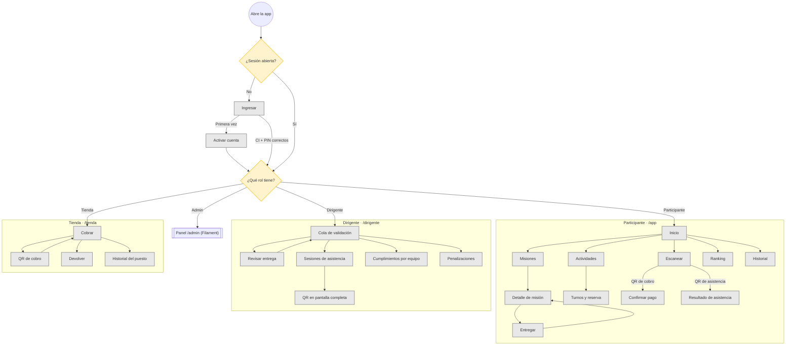

# Mapa general de pantallas

Todas las pantallas móviles y cómo se llega a cada una. El admin trabaja en el panel Filament (no se detalla). Los atajos de la barra inferior de cada rol se describen en `UX-FLOWS.md`.

